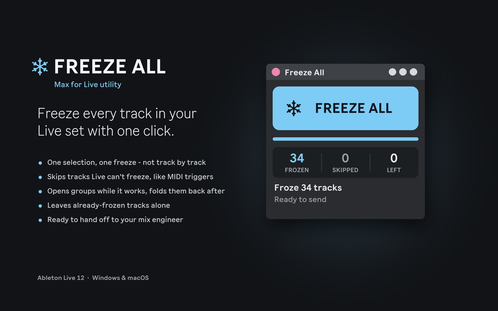

# Freeze All

Freeze every track in your Live set with one click, ready to hand off to your mix engineer.

**[⬇ Download the latest version (.zip)](../../releases/latest/download/Freeze_All_for_Ableton.zip)**

Tired of hunting through your set to freeze tracks before sending it off? Drop Freeze All on your Main track and click one button. It selects every track that can be frozen and freezes them all in a single go: one Freeze and one progress bar, not track by track.

It handles the things that usually break "select all → freeze":

- Tracks Live can't freeze (like an empty MIDI track that only triggers something else) are left out automatically, so Freeze never greys out.
- Groups are opened while it works and folded back when it's done.
- Already-frozen tracks are left as they are.

The panel shows how many tracks are ready to freeze, then how many it froze and anything it skipped, by name. Click again while it's running to stop.

## How to install

1. Download the zip above, unzip it, and put the whole "Freeze All" folder in your User Library, keeping all the files together.
2. Drag "Freeze All.amxd" onto your Main track.
3. Mac only: allow Live under System Settings → Privacy & Security → Accessibility. The included READ ME walks through it.

## Notes

- Freeze All drives Live's own Edit → Freeze command, so the results are exactly what you'd get freezing by hand.
- Keep your hands off the keyboard and mouse for the first few seconds while it selects your tracks.
- On Mac, a track that can't be frozen in the middle of your set splits the freeze into one pass above it and one below.
- macOS support is new. Feedback from Mac users is very welcome.

## Requirements

Ableton Live 12 with Max for Live (Suite, or Standard + Max for Live). Windows 10/11 or macOS.
